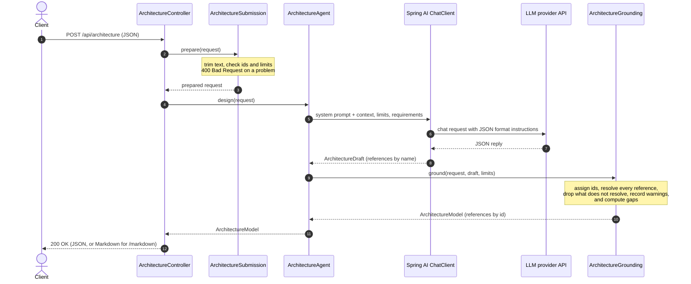
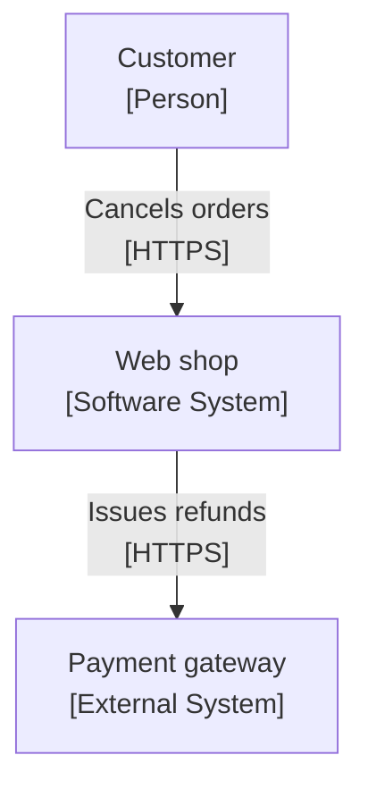
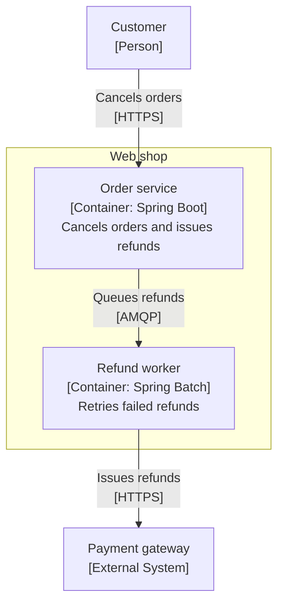
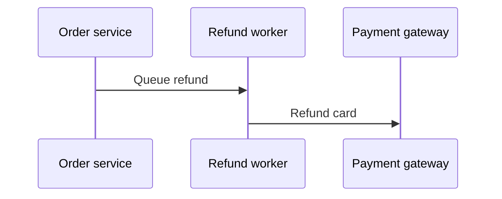

# Spring Boot AI Architecture Agent

A Spring AI service that turns reviewed **user stories** and **non-functional requirements (NFRs)** into a first draft of the **software architecture**: C4 context and container diagrams, sequence diagrams for key flows, a domain model, a deployment diagram, architecture decision records (ADRs), and an NFR traceability matrix. Send the requirements as JSON and get a validated architecture model back as JSON, or as one Markdown document with Mermaid diagrams that GitHub, GitLab, Confluence, and most wikis render.

It is the next step after the [Spring Boot AI Requirements Agent](https://github.com/tufangorel/spring-boot-ai-sdlc-requirements-agent): the `stories` and `nonFunctionalRequirements` that agent returns, after the team has reviewed them, can be sent here unchanged. Any other source works too, as long as each story and NFR has an id.

The API works with either **OpenAI** or **Anthropic (Claude)** models. Set `AI_PROVIDER` to `openai` (the default) or `anthropic`, give the matching API key in `OPENAI_API_KEY` or `ANTHROPIC_API_KEY`, and optionally pick a model with `OPENAI_MODEL` or `ANTHROPIC_MODEL`.

The output is a draft for an architect to review, not an approved design. Every decision is marked **Proposed**.

See [docs/sample-architecture.md](docs/sample-architecture.md) for a complete generated document.

## Artifacts

| Artifact | Format | Built from |
|----------|--------|------------|
| C4 system context diagram | Mermaid flowchart | actors, external systems, relationships |
| C4 container diagram and container table | Mermaid flowchart, Markdown table | containers, relationships |
| Sequence diagram per key flow | Mermaid `sequenceDiagram` | flows |
| Domain model | Mermaid `erDiagram` | entities, entity relations |
| Deployment diagram | Mermaid flowchart | deployment nodes |
| Architecture decision records | Markdown (Michael Nygard's format) | decisions |
| NFR traceability matrix | Markdown table | NFRs, NFR tactics |

The model returns one structured architecture model, and the service renders every artifact from it in code. The diagrams therefore cannot contradict each other: a container has the same name, id, and technology in the container diagram, the sequence diagrams, the deployment diagram, and the matrix. The model never writes Mermaid itself, so a diagram cannot fail to render because of a syntax error. All text from the model is escaped before it goes into a diagram.

## How the output is kept honest

Models tend to add components and technologies nobody asked for, and to refer to things that do not exist. The service checks every reference before returning the model:

- The model refers to elements by name. The service gives them ids: actors `A-1`, external systems `X-1`, containers `C-1`, entities `E-1`, decisions `ADR-1`, and deployment nodes `D-1`. Names are compared ignoring letter case and extra spaces, and a name may be used only once across actors, external systems, and containers.
- Requirement ids in containers and decisions must be ids from the request. Unknown ids are removed.
- A relationship, flow step, or entity relation that names an unknown element is dropped.
- A flow must belong to a story in the request, and each story gets at most one flow. A flow left with no valid steps is dropped.
- A tactic must belong to an NFR in the request and must say what it does. Unknown containers in a tactic are removed.
- A decision needs a title and a decision.
- Deployment nodes are only kept when the request has a `deploymentTarget`. Without one, any nodes are ignored and the open questions ask where the system will run.
- Containers, entities, flows, and decisions are capped by the limits under [Configuration](#configuration).

Everything dropped or removed is listed in `warnings`, so nothing disappears without a trace.

### Gaps

The service also reports what the design leaves open, in `gaps`:

| Field | Meaning |
|-------|---------|
| `untracedContainers` | Containers that serve no story or NFR. Either a requirement is missing or the container is not needed. |
| `unaddressedNfrs` | NFRs that no tactic addresses. They are also marked **Not addressed** in the traceability matrix. |
| `storiesWithoutFlow` | Stories with no sequence diagram. This is normal for simple stories. |
| `unhostedContainers` | Containers that no deployment node hosts. Only reported when there are deployment nodes. |

## Tech stack

- Java 25
- Spring Boot 4.1.1 (Web MVC, Validation, Actuator)
- Spring AI 2.0.1 with the OpenAI and Anthropic model starters
- springdoc-openapi 3.1.1 (OpenAPI spec and Swagger UI)
- Maven (wrapper included)

## Getting started

### Prerequisites

- JDK 25
- An API key for the provider you want to use: OpenAI or Anthropic

### Run

| Setting | Values | Default |
|---------|--------|---------|
| `AI_PROVIDER` | `openai` or `anthropic` | `openai` |
| `OPENAI_MODEL` | Any OpenAI chat model | `gpt-4o-mini` |
| `ANTHROPIC_MODEL` | Any Claude model ID | `claude-haiku-4-5` |

An architecture model is larger than a list of user stories, so a stronger model (for example `gpt-4o` or `claude-sonnet-4-5`) gives noticeably better designs.

Pass the API key as an environment variable. A key given as a command-line argument is visible in the process list and shell history.

OpenAI, Windows PowerShell:

```powershell
$env:OPENAI_API_KEY="sk-..."
.\mvnw.cmd spring-boot:run
```

OpenAI, macOS / Linux:

```bash
export OPENAI_API_KEY="sk-..."
./mvnw spring-boot:run
```

Anthropic Claude, Windows PowerShell:

```powershell
$env:AI_PROVIDER="anthropic"
$env:ANTHROPIC_API_KEY="sk-ant-..."
.\mvnw.cmd spring-boot:run
```

Swagger UI is at `http://localhost:8080/swagger-ui.html`. Health is at `/actuator/health`.

Requirements sent to this service are forwarded to the configured model provider. Do not send confidential material your organization does not allow to leave its network, and do not expose the API on an untrusted network without authentication in front of it.

## Sequence diagram

The flow of a single `POST /api/architecture` request:



If the model call fails, the error goes back to the caller and no partial result is returned.

## API

| Endpoint | Body | Returns | Calls the model |
|----------|------|---------|-----------------|
| `POST /api/architecture` | Requirements and context | Architecture model as JSON | Yes |
| `POST /api/architecture/markdown` | Requirements and context | Markdown document (`text/markdown`) | Yes |
| `POST /api/architecture/render` | An architecture model, possibly edited | Markdown document (`text/markdown`) | No |

### Design the architecture

```bash
curl -X POST http://localhost:8080/api/architecture \
  -H "Content-Type: application/json" \
  -d @request.json
```

`request.json`:

```json
{
  "requirements": {
    "summary": "Order cancellation and refunds for customers.",
    "stories": [
      {
        "id": "US-1",
        "title": "Cancel an unshipped order",
        "story": "As a customer, I want to cancel my order before it ships, so that I am not charged for something I no longer want.",
        "acceptanceCriteria": [
          { "id": "AC-1.1", "given": "an order that has not shipped", "when": "the customer cancels it", "then": "the order status is Cancelled" },
          { "id": "AC-1.2", "given": "an order that has shipped", "when": "the customer tries to cancel it", "then": "the request is refused" }
        ]
      },
      {
        "id": "US-2",
        "title": "Refund to the original payment method",
        "story": "As a customer, I want my money back on the card I paid with, so that I do not have to ask for it.",
        "acceptanceCriteria": [
          { "id": "AC-2.1", "given": "a cancelled order paid by card", "when": "the refund is issued", "then": "the amount is credited to that card" }
        ]
      }
    ],
    "nonFunctionalRequirements": [
      { "id": "NFR-1", "category": "PERFORMANCE", "statement": "Refunds reach the original payment method within 5 business days." }
    ]
  },
  "context": {
    "systemName": "Web shop",
    "existingSystems": [ { "name": "Payment gateway", "description": "Card payments and refunds" } ],
    "technologyConstraints": [ "Java and Spring Boot", "PostgreSQL" ],
    "deploymentTarget": "AWS EKS",
    "constraints": [ "GDPR applies" ]
  }
}
```

#### Request fields

| Field | Required | Notes |
|-------|----------|-------|
| `requirements.stories[]` | Yes, at least one | Each needs an `id`. `title`, `story`, and `acceptanceCriteria` (`id`, `given`, `when`, `then`) are optional but give the model more to work with. |
| `requirements.nonFunctionalRequirements[]` | No | Each needs an `id` and a `statement`. `category` is free text. |
| `requirements.summary` | No | |
| `context.systemName` | No | Used as the system's name in the diagrams. Defaults to `System`. |
| `context.existingSystems[]` | No | Systems the new one may talk to, with `name` and `description`. |
| `context.technologyConstraints[]` | No | Technologies the design should prefer. |
| `context.deploymentTarget` | No | Where the system runs, such as `AWS EKS` or `On-premises VMs`. Without it there is no deployment diagram. |
| `context.constraints[]` | No | Any other constraints, such as regulations or team skills. |

Ids must be unique across stories and NFRs, ignoring letter case. A story or NFR without an id, a duplicate id, an NFR without a statement, or a request over a size or count limit is rejected with **400 Bad Request** before the model is called. Text is trimmed and empty entries are removed.

#### Response

The JSON response is the architecture model: `systemName`, `summary`, the `stories` and `nonFunctionalRequirements` it was designed for, `actors`, `externalSystems`, `containers`, `relationships`, `entities`, `entityRelations`, `flows`, `decisions`, `nfrTactics`, `deploymentTarget`, `deploymentNodes`, `gaps`, `assumptions`, `openQuestions`, and `warnings`. Elements refer to each other by id, for example a relationship from `A-1` to `C-1`, and a deployment node that hosts `["C-1", "C-2"]`.

`POST /api/architecture/markdown` takes the same request and returns the model rendered as Markdown. [docs/sample-architecture.md](docs/sample-architecture.md) is the document generated for the request above. Sections with nothing to show, such as the domain model when there are no entities, are left out.

### Render an edited model

An architect rarely accepts a first draft as it is. To keep the artifacts consistent after review:

1. Call `POST /api/architecture` and save the JSON response.
2. Edit the model: rename a container, add a relationship, fix a flow, or delete a decision. Keep the ids consistent.
3. Send the edited model to `POST /api/architecture/render` to get the Markdown document again.

The model is not called, so this is fast, free, and gives the same output every time. Gaps are worked out again from the edited model, so the document shows what the edits have closed or opened. `warnings` are shown as they are in the body.

For example, the architect replaces the web app with a separate refund worker and draws the refund flow:

```json
{
  "systemName": "Web shop",
  "summary": "Order cancellation with refunds retried by a worker.",
  "stories": [
    { "id": "US-1", "title": "Cancel an unshipped order" },
    { "id": "US-2", "title": "Refund to the original payment method" }
  ],
  "nonFunctionalRequirements": [
    { "id": "NFR-1", "category": "PERFORMANCE", "statement": "Refunds reach the original payment method within 5 business days." }
  ],
  "actors": [ { "id": "A-1", "name": "Customer" } ],
  "externalSystems": [ { "id": "X-1", "name": "Payment gateway" } ],
  "containers": [
    { "id": "C-1", "name": "Order service", "technology": "Spring Boot", "responsibility": "Cancels orders and issues refunds", "requirementIds": ["US-1", "US-2"] },
    { "id": "C-2", "name": "Refund worker", "technology": "Spring Batch", "responsibility": "Retries failed refunds", "requirementIds": ["NFR-1"] }
  ],
  "relationships": [
    { "from": "A-1", "to": "C-1", "description": "Cancels orders", "protocol": "HTTPS" },
    { "from": "C-1", "to": "C-2", "description": "Queues refunds", "protocol": "AMQP" },
    { "from": "C-2", "to": "X-1", "description": "Issues refunds", "protocol": "HTTPS" }
  ],
  "flows": [
    {
      "storyId": "US-2",
      "title": "Refund to the original payment method",
      "steps": [
        { "from": "C-1", "to": "C-2", "message": "Queue refund" },
        { "from": "C-2", "to": "X-1", "message": "Refund card" }
      ]
    }
  ],
  "nfrTactics": [
    { "nfrId": "NFR-1", "tactic": "Refund worker retries failed refunds every hour", "containerIds": ["C-2"] }
  ]
}
```

Response:

````markdown
# Architecture: Web shop

Order cancellation with refunds retried by a worker.

## System context



## Containers



| Id | Container | Technology | Responsibility | Requirements |
|----|-----------|------------|----------------|--------------|
| C-1 | Order service | Spring Boot | Cancels orders and issues refunds | US-1, US-2 |
| C-2 | Refund worker | Spring Batch | Retries failed refunds | NFR-1 |

## Key flows

### US-2: Refund to the original payment method



## NFR traceability

| NFR | Category | Statement | Tactic | Containers |
|-----|----------|-----------|--------|------------|
| NFR-1 | PERFORMANCE | Refunds reach the original payment method within 5 business days. | Refund worker retries failed refunds every hour | Refund worker |

## Gaps

- **Stories without a flow:** US-1
````

In the context diagram, the containers are drawn as the one system they belong to, and relationships between containers are left out. A step or relationship that refers to an id that is not in the model is skipped. Missing lists are treated as empty.

The request is rejected with **400 Bad Request** when `containers` is missing or empty, or when the body is not valid JSON.

### Configuration

| Property | Default | Applies to |
|----------|---------|------------|
| `architecture.max-requirement-characters` | 20000 | Total text in `requirements` |
| `architecture.max-context-characters` | 4000 | Total text in `context` |
| `architecture.max-stories` | 30 | Stories per request |
| `architecture.max-nfrs` | 30 | NFRs per request |
| `architecture.max-containers` | 12 | Containers kept from the model |
| `architecture.max-entities` | 15 | Entities kept from the model |
| `architecture.max-flows` | 8 | Flows kept from the model |
| `architecture.max-decisions` | 8 | Decisions kept from the model |

The model is told the limits for containers, entities, flows, and decisions. Anything over a limit is dropped and listed in `warnings`.

## Tests

```bash
./mvnw verify
```

On Windows: `.\mvnw.cmd verify`.

The tests use a stub chat model. They do not call OpenAI or Anthropic. The renderers are tested against exact output, and the samples in this README and in `docs/sample-architecture.md` are checked against the code. The JaCoCo coverage report is at `target/site/jacoco/index.html`.
