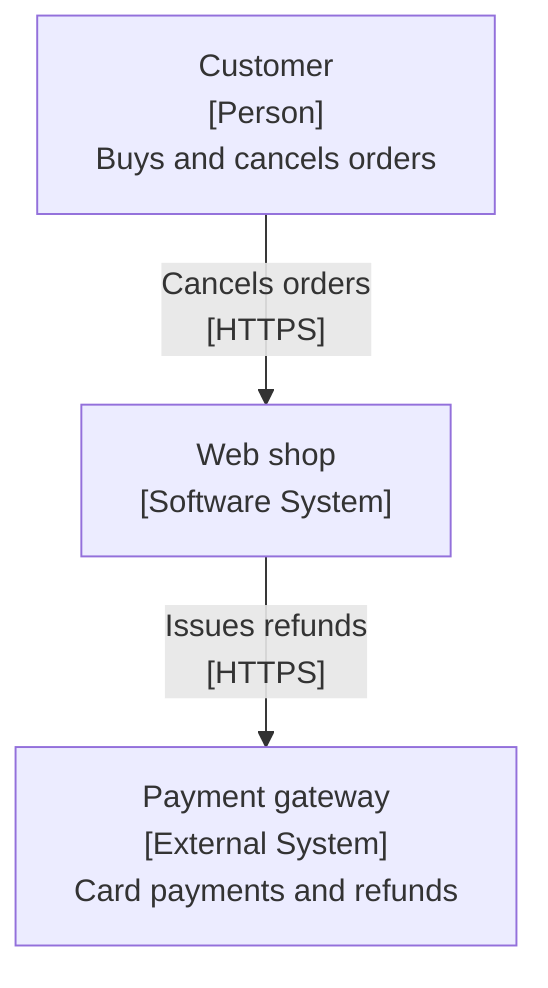
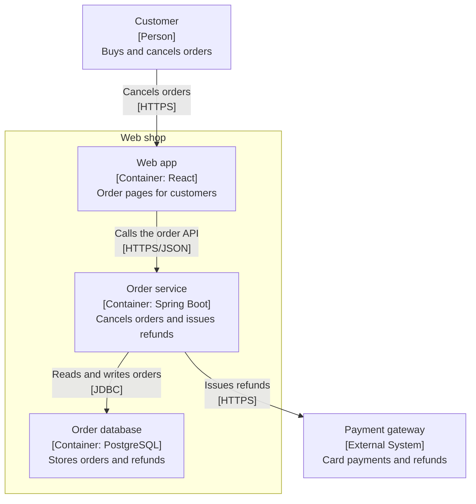
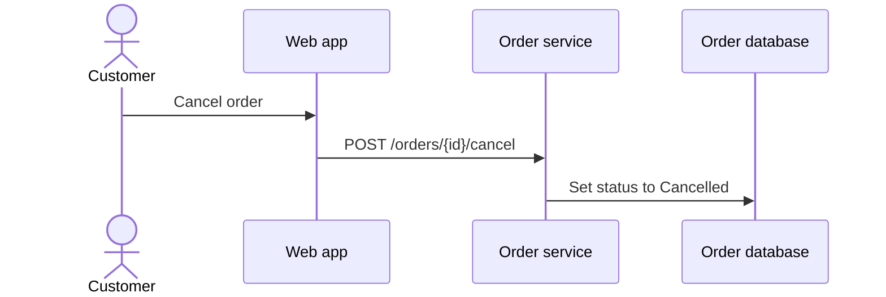
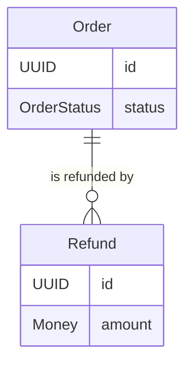
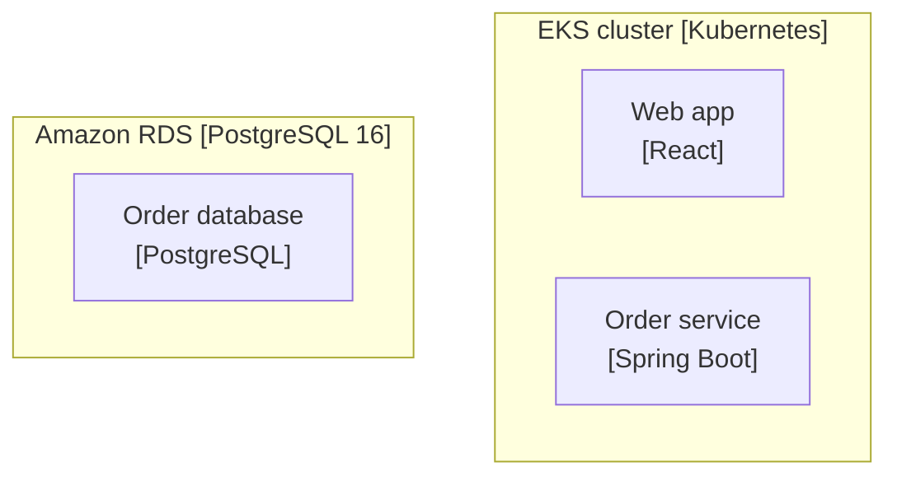

# Architecture: Web shop

A web app calls a Spring Boot order service that stores orders in PostgreSQL and refunds through the payment gateway.

## System context

## Containers

| Id | Container | Technology | Responsibility | Requirements |
|----|-----------|------------|----------------|--------------|
| C-1 | Web app | React | Order pages for customers | US-1 |
| C-2 | Order service | Spring Boot | Cancels orders and issues refunds | US-1, US-2, NFR-1 |
| C-3 | Order database | PostgreSQL | Stores orders and refunds | US-1, US-2 |

## Key flows

### US-1: Cancel an unshipped order

## Domain model

## Deployment: AWS EKS

## Architecture decisions

### ADR-1: Issue refunds asynchronously

- **Status:** Proposed
- **Requirements:** US-2, NFR-1

**Context:** The payment gateway can be slow or unavailable, and refunds must arrive within 5 business days.

**Decision:** The order service records a pending refund and a scheduled job sends it to the payment gateway, retrying on failure.

**Alternatives considered:**

- Refund synchronously during cancellation

**Consequences:** Cancellation stays fast; refunds need monitoring.

## NFR traceability

| NFR | Category | Statement | Tactic | Containers |
|-----|----------|-----------|--------|------------|
| NFR-1 | PERFORMANCE | Refunds reach the original payment method within 5 business days. | Retry failed refunds with a scheduled job and alert after 3 days | Order service |

## Gaps

- **Stories without a flow:** US-2

## Assumptions

- Refunds are only issued to cards

## Open questions

- Who is alerted when a refund keeps failing?
