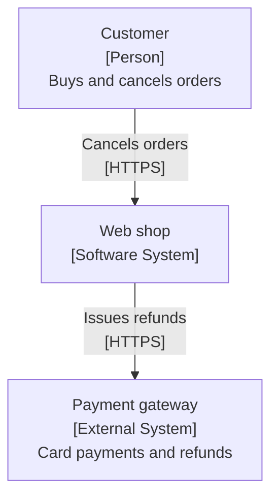
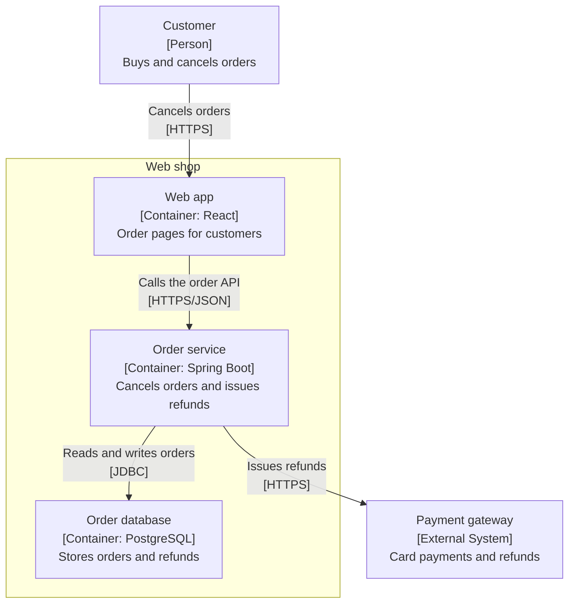
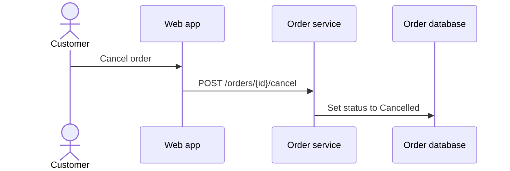
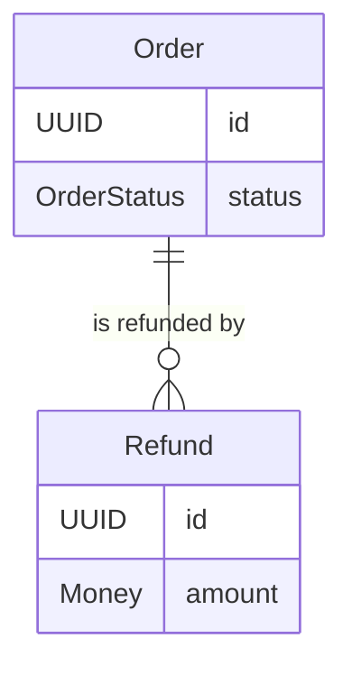
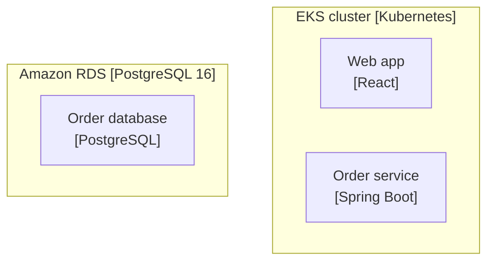

# Architecture: Web shop

A web app calls a Spring Boot order service that stores orders in PostgreSQL and refunds through the payment gateway.

## System context



## Containers



| Id | Container | Technology | Responsibility | Requirements |
|----|-----------|------------|----------------|--------------|
| C-1 | Web app | React | Order pages for customers | US-1 |
| C-2 | Order service | Spring Boot | Cancels orders and issues refunds | US-1, US-2, NFR-1 |
| C-3 | Order database | PostgreSQL | Stores orders and refunds | US-1, US-2 |

## Key flows

### US-1: Cancel an unshipped order



## Domain model



## Deployment: AWS EKS



## Architecture decisions

### ADR-1: Issue refunds asynchronously

- **Status:** Proposed
- **Requirements:** US-2, NFR-1

**Context:** The payment gateway can be slow or unavailable, and refunds must arrive within 5 business days.

**Decision:** The order service records a pending refund and a scheduled job sends it to the payment gateway, retrying on failure.

**Alternatives considered:**

- Refund synchronously during cancellation

**Consequences:** Cancellation stays fast; refunds need monitoring.

## NFR traceability

| NFR | Category | Statement | Tactic | Containers |
|-----|----------|-----------|--------|------------|
| NFR-1 | PERFORMANCE | Refunds reach the original payment method within 5 business days. | Retry failed refunds with a scheduled job and alert after 3 days | Order service |

## Gaps

- **Stories without a flow:** US-2

## Assumptions

- Refunds are only issued to cards

## Open questions

- Who is alerted when a refund keeps failing?

## Structurizr DSL

```dsl
workspace "Web shop" "A web app calls a Spring Boot order service that stores orders in PostgreSQL and refunds through the payment gateway." {

    model {
        actor_A1 = person "Customer" "Buys and cancels orders"
        ext_X1 = softwareSystem "Payment gateway" "Card payments and refunds" "External"
        mainSystem = softwareSystem "Web shop" "A web app calls a Spring Boot order service that stores orders in PostgreSQL and refunds through the payment gateway." {
            c_C1 = container "Web app" "Order pages for customers" "React"
            c_C2 = container "Order service" "Cancels orders and issues refunds" "Spring Boot"
            c_C3 = container "Order database" "Stores orders and refunds" "PostgreSQL" "Database"
        }
        actor_A1 -> c_C1 "Cancels orders" "HTTPS"
        c_C1 -> c_C2 "Calls the order API" "HTTPS/JSON"
        c_C2 -> c_C3 "Reads and writes orders" "JDBC"
        c_C2 -> ext_X1 "Issues refunds" "HTTPS"

        deploymentEnvironment "AWS EKS" {
            node_D1 = deploymentNode "EKS cluster" "" "Kubernetes" {
                containerInstance c_C1
                containerInstance c_C2
            }
            node_D2 = deploymentNode "Amazon RDS" "" "PostgreSQL 16" {
                containerInstance c_C3
            }
        }
    }

    views {
        systemContext mainSystem "SystemContext" {
            include *
            autoLayout
        }

        container mainSystem "Containers" {
            include *
            autoLayout
        }

        deployment mainSystem "AWS EKS" "Deployment" {
            include *
            autoLayout
        }

        dynamic mainSystem "flow_US1" "Cancel an unshipped order" {
            actor_A1 -> c_C1 "Cancel order"
            c_C1 -> c_C2 "POST /orders/{id}/cancel"
            c_C2 -> c_C3 "Set status to Cancelled"
            autoLayout
        }

        styles {
            element "Person" {
                shape Person
                background #08427b
                color #ffffff
            }
            element "Software System" {
                background #1168bd
                color #ffffff
            }
            element "External" {
                background #999999
                color #ffffff
            }
            element "Container" {
                background #438dd5
                color #ffffff
            }
            element "Database" {
                shape Cylinder
            }
        }
    }
}
```
